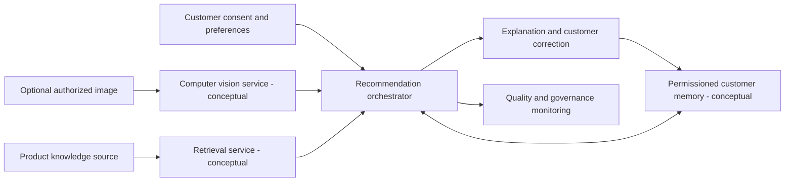

# Omnichannel AI Retail Curator

**Personalization product architecture and interactive recommendation simulation**

[Try the browser demonstration](https://msb24.github.io/ai-omnichannel-retail-curator/)

> A Georgetown AI product-design case study and an accompanying, newly built browser demo using a fictional catalog and deterministic ranking rules. **The live page does not run computer vision or RAG inference.** Those appear in the proposed architecture and implementation backlog.

## Product question

How could an AI retail experience combine customer preferences, product attributes, image interpretation, retrieval of relevant product knowledge, and customer-controlled memory while preserving explainability and correction rights?

## Try the interactive demo

1. Choose a shopping occasion such as Night out or Office style.
2. Choose a style preference, budget, and category.
3. Observe how a fictional set of products reorders based on transparent matching rules.
4. Enable **Remember these preferences** only with consent. Reload the browser page to see the locally saved preference.
5. Choose **Forget saved preferences**, then refresh to confirm the saved record is gone.

## Scope of graduate work

- Designed the broader omnichannel customer journey with computer-vision-assisted discovery, RAG-based product explanation, customer memory, governance controls, and human correction.
- Mapped system boundaries, architecture, implementation backlog, rollout considerations, and KPIs for recommendation relevance, adoption, and trust.
- Considered how preference updates or deletion should propagate across a real product's memory and integration systems.

## How this demo works

`index.html` is a self-contained browser app using HTML, CSS, and JavaScript. It scores **fictional products** using declared preference and occasion matches. Optional memory is stored only in the user's own browser local storage, after consent. No accounts, payments, external APIs, product inventory feeds, or cloud databases are connected.

## Planned production architecture (conceptual)

1. Customer experience collects explicit shopping preferences and, where authorized, visual input.
2. Computer vision component produces permitted image features.
3. Product retrieval component looks up item attributes and source-backed explanations.
4. A recommendation/ranking layer combines relevance, budget, availability, and user correction.
5. Customer memory stores only authorized preferences and supports inspection, correction, and deletion.
6. Monitoring and governance controls audit source quality, privacy compliance, and user-facing recommendation outcomes.

These are **architectural requirements**, not deployed features of the demo.

### Proposed system architecture

**Architecture proposal only.** The browser page demonstrates local, deterministic matching and optional on-device preference storage. It does not run the conceptual services shown here.

## Design decisions that matter

- A transparent prototype is preferable to a fake claim that a recommender model is running.
- A user should be able to see and correct what the system remembers about them.
- Explanations should identify which data and preferences drove a recommendation.
- A later production implementation would require consent handling across all downstream systems and testing for uneven recommendation outcomes.

## Skills demonstrated

AI product architecture, recommendation and RAG concepts, privacy-aware customer memory, human-centered correction, requirements, implementation backlog, KPI design, prototype interaction design. Browser demo developed with AI-assisted coding and manually reviewed scenario logic.
